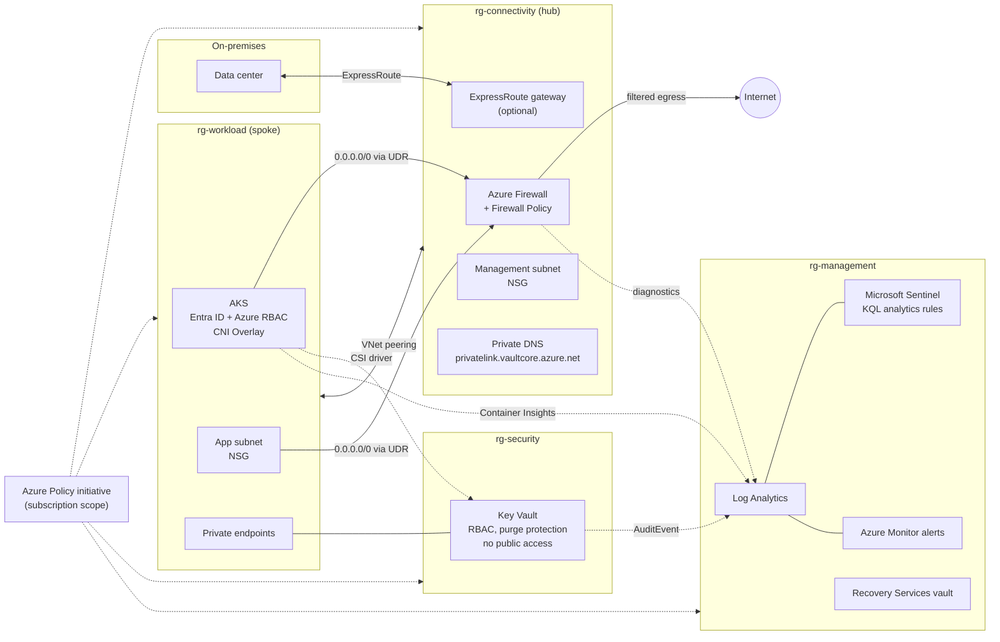

# Azure Landing Zone - Terraform

[](https://github.com/NamanaPrasanth/azure-landing-zone-terraform/actions/workflows/terraform-ci.yml)


A production-style **hub-and-spoke Azure landing zone**, built from reusable Terraform modules and shipped through a GitHub Actions pipeline.

It covers the building blocks a Senior Cloud Engineer is expected to own: network segmentation and egress control, hybrid connectivity, identity-first security, governance with Azure Policy, central logging and SIEM, Kubernetes, alerting, and backup.

## Architecture



More detail and the reasoning behind each choice: [docs/architecture.md](docs/architecture.md).

## What is in the repo

```
.
├── modules/                    Reusable, independently versionable modules
│   ├── hub-network/            Hub VNet, Azure Firewall + policy, ExpressRoute gateway
│   ├── spoke-network/          Spoke VNet, NSGs, UDR to firewall, hub peering
│   ├── log-analytics/          Workspace, Activity Log export, Sentinel + KQL rules
│   ├── key-vault/              RBAC Key Vault with private endpoint
│   ├── policy/                 Custom initiative, tag inheritance, deny-public-IP policy
│   ├── aks/                    Hardened AKS with UDR egress and Key Vault CSI
│   ├── monitoring/             Action group, Activity Log, metric and KQL alerts
│   └── backup/                 Recovery Services vault and VM backup policy
├── environments/
│   └── dev/                    Root module that composes the modules
│       └── tests/              terraform test suite (mocked provider)
├── scripts/
│   ├── bootstrap-state.sh      Remote state storage (Entra ID auth, versioning)
│   └── setup-github-oidc.sh    Passwordless GitHub -> Azure login (OIDC)
├── .github/workflows/          CI/CD pipeline
├── docs/                       Architecture notes and walkthrough
└── Makefile                    fmt / validate / lint / test / plan / apply
```

| Module | Key Azure services |
|---|---|
| [hub-network](modules/hub-network) | VNet, Azure Firewall, Firewall Policy, ExpressRoute gateway, NSG |
| [spoke-network](modules/spoke-network) | VNet, subnets, NSGs, route table (UDR), VNet peering |
| [log-analytics](modules/log-analytics) | Log Analytics, Microsoft Sentinel, KQL analytics rules, saved searches |
| [key-vault](modules/key-vault) | Key Vault (RBAC), Private Endpoint, diagnostic settings |
| [policy](modules/policy) | Policy initiative, built-in + custom definitions, Modify remediation identity |
| [aks](modules/aks) | AKS, user-assigned identity, Key Vault CSI, Workload Identity, Container Insights |
| [monitoring](modules/monitoring) | Action group, Activity Log alerts, metric alerts, log search (KQL) alerts |
| [backup](modules/backup) | Recovery Services vault, VM backup policy |

## CI/CD pipeline

`.github/workflows/terraform-ci.yml` runs on every push and pull request:

| Stage | What it does | Needs Azure? |
|---|---|---|
| `fmt` | `terraform fmt -check -recursive` | No |
| `validate` | `init -backend=false` + `validate` for every module and the environment (matrix) | No |
| `test` | `terraform test` with a mocked azurerm provider | No |
| `tflint` | Lints with the azurerm ruleset (invalid SKUs, naming, undocumented variables) | No |
| `checkov` | Security scan; results uploaded as SARIF | No |
| `plan` | OIDC login, `terraform plan`, plan posted as a PR comment | Yes |
| `apply` | Manual trigger, gated by a GitHub environment with required reviewers | Yes |

No client secrets are stored: GitHub exchanges a short-lived OIDC token for an Azure access token. The `plan` and `apply` stages stay off until `AZURE_PLAN_ENABLED` is set (see [Deploy](#deploy)).

## Run the checks locally

```bash
make fmt        # format
make validate   # validate every module + environment
make lint       # tflint
make test       # mocked terraform tests - no Azure subscription needed
```

## Deploy

**Prerequisites:** Terraform ≥ 1.11, Azure CLI, Owner (or Contributor + User Access Administrator + Resource Policy Contributor) on the subscription.

```bash
az login

# 1. One-time: register encryption at host for AKS nodes
az feature register --namespace Microsoft.Compute --name EncryptionAtHost
az provider register --namespace Microsoft.Compute

# 2. One-time: create remote state storage
./scripts/bootstrap-state.sh <subscription-id> centralus
#    -> paste the printed values into environments/dev/backend.hcl

# 3. Configure variables
cp environments/dev/terraform.tfvars.example environments/dev/terraform.tfvars
#    -> set subscription_id, owner, cost_center, alert_emails

# 4. Plan and apply
make plan
make apply
```

To run plans from GitHub Actions, run `./scripts/setup-github-oidc.sh <subscription-id> <owner/repo>` and add the secrets and variables it prints.

### Cost

Azure Firewall Standard and AKS are the main costs while running (roughly $1.25/hour for the firewall alone; check the [Azure pricing calculator](https://azure.microsoft.com/pricing/calculator/) for current rates). For a short demo:

```hcl
firewall_enabled = false   # spokes fall back to AKS load balancer egress
aks_enabled      = false
sentinel_enabled = false
```

Tear down with `make destroy` when finished. The ExpressRoute gateway is off by default.

## Design highlights

- **Egress control:** every spoke subnet (except private endpoints) has a `0.0.0.0/0` route to Azure Firewall; only allow-listed FQDNs and service tags get out.
- **Identity first:** Key Vault uses RBAC, AKS has local accounts disabled, CI uses OIDC, and managed identities replace secrets everywhere.
- **Private by default:** Key Vault has public access disabled and is resolved through a private DNS zone linked to hub and spoke.
- **Governance as code:** a custom Azure Policy initiative enforces allowed regions, mandatory tags and data-protection settings; a custom policy blocks public IPs in workload resource groups.
- **Observability built in:** every module sends diagnostics to one workspace; Sentinel analytics and Azure Monitor alerts are defined in KQL alongside the infrastructure.
- **Tested before it reaches Azure:** mocked `terraform test` runs cover the default design, the cost-saving mode and input validation.

## License

[MIT](LICENSE)
